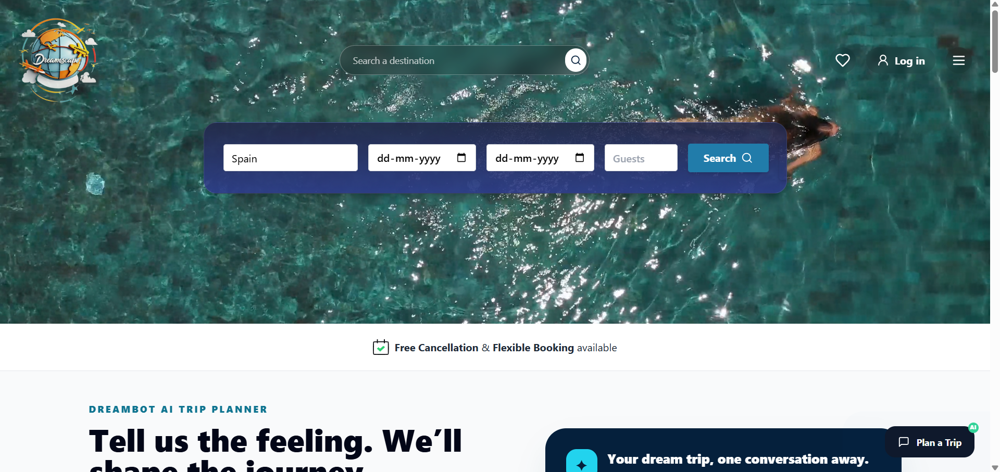

# Dreamscape

<p align="center">
  
</p>

<p align="center">
  Plan better trips, discover inspiring destinations, and keep every travel idea in one place.
</p>

<p align="center">
  <a href="https://github.com/Shivansh1251/Dreamscape">Repository</a>
  ·
  <a href="https://github.com/Shivansh1251/Dreamscape/issues">Report an issue</a>
</p>

## Preview



## About

Dreamscape is a full-stack travel planning application for exploring destinations, organizing trips, and getting travel recommendations. The project includes a React/Vite frontend and an Express/TypeScript backend with authentication, travel utilities, and AI-powered services.

## Features

- Explore destinations and detailed travel information
- Build and manage personalized travel plans
- Compare hotels and find nearby places
- Get itinerary, packing, food, weather, and safety recommendations
- Use AI-powered travel assistance and trip summaries
- Save favorite destinations and manage a user profile
- Responsive experience for desktop and mobile screens

## Tech stack

- **Frontend:** React, TypeScript, Vite, Tailwind CSS
- **Backend:** Node.js, Express, TypeScript
- **Services:** MongoDB, Passport authentication, OpenAI, weather integrations
- **Deployment:** Vercel configuration is included for both applications

## Getting started

### Prerequisites

- Node.js 18 or newer
- npm
- MongoDB, if you want to run the backend locally

### Installation

Clone the repository and install dependencies for both applications:

```sh
git clone https://github.com/Shivansh1251/Dreamscape.git
cd Dreamscape

cd frontend
npm install

cd ../backend
npm install
```

### Running locally

Start the backend in one terminal:

```sh
cd backend
npm run dev
```

Start the frontend in a second terminal:

```sh
cd frontend
npm run dev
```

Open the local URL printed by Vite in your browser.

> Configure the backend environment variables before starting the API. See [DEPLOY_VERCEL.md](./DEPLOY_VERCEL.md) for deployment-related configuration.

## Project structure

```text
.
├── frontend/    # React/Vite client application
├── backend/     # Express/TypeScript API
├── legacy/      # Earlier static implementation
├── Imgaes/      # Shared branding and travel imagery
└── DEPLOY_VERCEL.md
```

## Contributing

Contributions are welcome. Open an issue to discuss a change or submit a pull request with a clear description of the improvement.

## Connect with me

- **GitHub:** [@Shivansh1251](https://github.com/Shivansh1251)
- **Project discussions:** [Open an issue in Dreamscape](https://github.com/Shivansh1251/Dreamscape/issues)

## License

This project is licensed under the [MIT License](./LICENSE).
